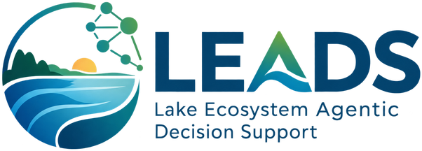

<p align="center">
  <picture>
    <source media="(prefers-color-scheme: dark)" srcset="tool/public/leads-logo-full-dark.png">
    
  </picture>
</p>

<p align="center">
  <a href="https://github.com/rohitshukla01/LEADS/actions/workflows/check-results.yml"></a>
  <a href="DOCKER.md"></a>
  <a href="#1-check-the-results-no-api-keys"></a>
  <a href="LICENSE.md"></a>
</p>

LEADS (Lake Ecosystem Agentic Decision Support) is a forecast-informed research and decision-support system for
drinking-water supply reservoirs. Built on a large language model, retrieval-augmented generation (RAG), and
computational tools, it integrates environmental sensor observations, ensemble water quality forecasts, and the research
literature to answer management questions. It evaluates current conditions against reservoir-specific operating rules,
interprets forecasted water quality risks in the context of historical forecast performance, provides source
attribution and verifies claims against retrieved evidence. Role-specific pathways provide managers with
decision-relevant operational guidance and researchers with evidence-based scientific interpretation. LEADS was tested
at two drinking water reservoirs in Virginia, USA.

## Repository contents

The repository has two parts.

### 1. Reproduce the paper's figures and results

| Path | Contents |
|---|---|
| [reproduce_paper/](reproduce_paper/) | Data and code that produce each figure and result |
| [reproduce.sh](reproduce.sh) | Redraws Figs 4 to 8, recomputes the numbers of Figs 5 and 6, rebuilds the forecast-skill records behind Figs 4d, 7 and 8, and checks each against the saved files (no API keys) |

The steps are under [1. Check the results](#1-check-the-results-no-api-keys).

### 2. Set up and run LEADS

| Path | Contents |
|---|---|
| [tool/](tool/) | LEADS source code ([guide](tool/README.md)) |
| [DOCKER.md](DOCKER.md) | Guide to running LEADS with Docker |
| [docker-compose.yml](docker-compose.yml), [docker.env.example](docker.env.example) | Docker set-up and settings |

The steps are under [2. Run LEADS](#2-run-leads).

## Get the repository

Clone the repository and go into its folder:

```bash
git clone https://github.com/rohitshukla01/LEADS.git
cd LEADS
```

You can also click **Code** > **Download ZIP**, unzip it and open a terminal in the `LEADS-main` folder.

## 1. Check the results (no API keys)

1. Install Python 3.12, 3.13 or 3.14 from [python.org](https://www.python.org/downloads/).
2. Rebuild all the results from the saved data at once:

   ```bash
   bash reproduce.sh
   ```

   The first run needs internet and takes 2 to 3 minutes.

3. Check that it ends with `12 checks, 0 failed.` The redrawn figures are saved in `reproduced_figures/`.

`reproduce.sh` is a bash script and was tested on macOS 14.8 (Apple M1, 8 GB). The repository is set up with GitHub Actions to automatically rerun these checks on every push that changes the code or data they use. The badge at the top shows whether they are currently passing or failing.

## 2. Run LEADS

LEADS is an agentic framework that needs several keys and services to run in full. First
[get the repository](#get-the-repository) with `git clone`, then run LEADS in one of two ways:

- To build your own LEADS from source with its full stack, follow the [tool guide](tool/README.md).
- To use LEADS with only a language-model key, run the Docker version we prepared, on your own computer, with
  today's public data. The steps are below; the full guide is in [`DOCKER.md`](DOCKER.md).

### Docker version

1. Install and start [Docker Desktop](https://www.docker.com/products/docker-desktop/).
2. Copy the settings file:

   ```bash
   cp docker.env.example .env
   ```

3. Open `.env` in a text editor. On macOS:

   ```bash
   open -e .env
   ```

4. Put your language-model key directly after `OPENAI_API_KEY=`. For another provider, such as Gemini or Claude, also make sure to remove the `# ` in front of that provider's three lines in `.env`.
5. Build and start LEADS:

   ```bash
   docker compose up --build
   ```

6. When the terminal shows `Ready in`, open http://localhost:3000, confirm the user profile and ask a question.

To stop LEADS, press Ctrl+C in the terminal.

## Data

Long-term reservoir monitoring data for Falling Creek and Beaverdam Reservoirs are published in the Environmental Data Initiative (EDI) repository ([Carey, Breef-Pilz, et al., 2026](https://doi.org/10.6073/pasta/96955da18a4bb1d01137837e73e79d5e); [Carey & Breef-Pilz, 2025a](https://doi.org/10.6073/pasta/8f666b34c120aa5d2242964cf3147f90), [2025b](https://doi.org/10.6073/pasta/f74fd5c5fc9ea4141a662ce773962ce0)). We generated water quality forecasts for the reservoirs with the FLARE forecasting software, which is available on Zenodo ([Thomas et al., 2026](https://doi.org/10.5281/zenodo.20366259)).

## Not included

- The PDF files of the published research papers (listed with titles and DOIs in [tool/data/papers.csv](tool/data/papers.csv)).
- The experts' names and written comments (Fig. 6).
- API keys.

## How to cite

If you use the code, data or framework in this repository, please cite it (see [CITATION.cff](CITATION.cff)).

## Licence

The code is free for non-commercial use under the PolyForm Noncommercial License 1.0.0 (see [LICENSE.md](LICENSE.md)).

## Acknowledgements

We thank the five confidential freshwater experts who independently evaluated LEADS responses. We are grateful to the Western Virginia Water Authority (WVWA) for providing access to Falling Creek and Beaverdam Reservoirs, associated data, and long-term collaboration. We also thank past and present members of the Virginia Reservoirs Long-Term Research in Environmental Biology (LTREB) and Reservoir Group teams for field monitoring and long-term data collection, and the Virginia Tech Center for Ecosystem Forecasting for supporting the forecasting resources used in this study. This work was supported by the U.S. National Science Foundation (NSF) awards 2209866, 2327030, and 2213549. Virginia Tech determined that this project does not meet the federal definition of human subjects research (IRB-26-1186).
